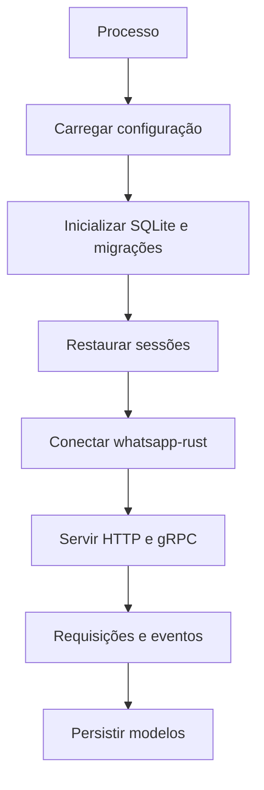

# Fluxo operacional

## Objetivo

Descrever o fluxo pretendido e separar o que é executável do que está apenas planejado.

## Estado atual

Não existe fluxo executável completo. `src/main.rs` contém um `main` assíncrono, mas há tokens sem definição (`token`, `database_url`, `state`), chamada incompleta de `match`, referências a `db::initialize`/`auth::ensure_admin_token` inexistentes e não há retorno sintaticamente válido após `init(token)`.

## Fluxo pretendido

O desenho sugerido pelo README é:

Nenhuma dessas etapas está implementada de ponta a ponta. Há apenas `config::init`, `database::init` e a criação parcial de um listener Axum no arquivo de entrada.

## Configuração e banco

`src/config/mod.rs` define `Config`, `Database`, `Service` e `Media`, valida strings não vazias e porta diferente de zero, mas procura `kronos_pdv.toml`, não `uwah.toml`. A configuração versionada contém caminhos diferentes. `src/database/mod.rs` lê `database.dir`, habilita foreign keys, WAL, `NORMAL`, cria o arquivo e abre pool SQLite com no máximo cinco conexões. A função recebe `token`, mas não o utiliza. Não há chamada real à migration.

## APIs, sessões e eventos

Os diretórios de API e rotas não possuem handlers. Não há criação/recuperação de sessão, QR code, reconexão, envio de mensagem, consumidores de eventos ou shutdown coordenado. `src/repository/sessions.rs` apenas esboça operações SQL.

## Erros e observabilidade

Repositórios usam `anyhow::Context`; a inicialização do banco usa `expect`, convertendo falhas em panic. `src/log/mod.rs` configura tracing no console e em `uwah.log`, mas não é chamado pelo `main` atual.
