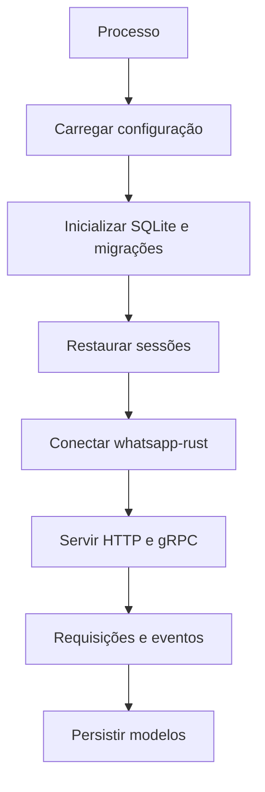

# Fluxo operacional

## Objetivo

Descrever o fluxo atual e separar capacidades implementadas de lacunas conhecidas.

## Estado atual

`src/main.rs` inicializa logging, configuração, pool SQLite e migrations; cria `SessionManager`, event bus e router HTTP; hidrata sessões conectadas; inicia outbox e manutenção; sobe o gRPC na porta `service.port + 1`; serve REST e executa shutdown coordenado.

## Fluxo pretendido

O desenho sugerido pelo README é:

Nenhuma dessas etapas está implementada de ponta a ponta. Há apenas `config::init`, `database::init` e a criação parcial de um listener Axum no arquivo de entrada.

## Configuração e banco

`src/config/mod.rs` define `Config`, `Database`, `Service`, `Media`, `Sessions` e `Webhook`, valida os campos e carrega `uwah.toml`. `src/database/mod.rs` lê `database.dir`, habilita foreign keys, WAL, `NORMAL`, abre pool SQLite com no máximo cinco conexões e executa as migrations.

## APIs, sessões e eventos

As APIs HTTP, o servidor gRPC, a criação/recuperação de sessão, QR code, envio de mensagens, consumidores de eventos e shutdown coordenado estão implementados. O grau de suporte de cada recurso deve ser conferido em `docs/API.md` e nos handlers correspondentes.

## Erros e observabilidade

Repositórios usam `anyhow::Context`; a inicialização do banco usa `expect`, convertendo falhas em panic. `src/log/mod.rs` configura tracing no console e em `uwah.log`, mas não é chamado pelo `main` atual.
