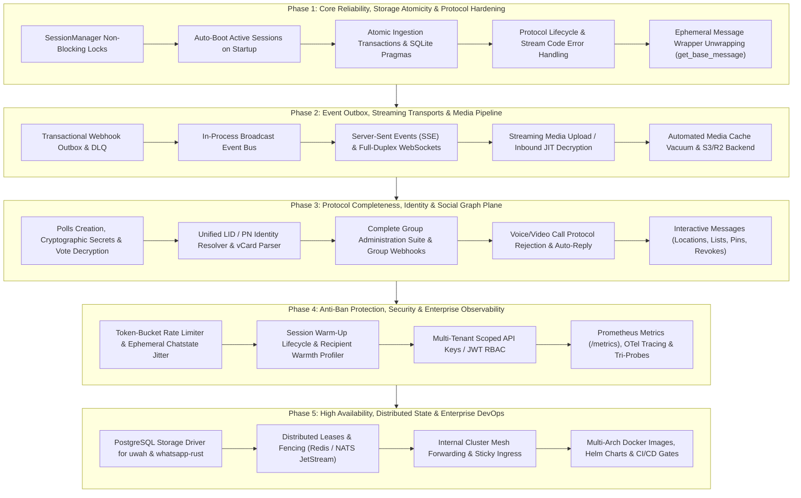

# 🗺️ UWAH Project Roadmap & Technical Architecture Evolution

> **Status:** Approved Architectural Specification & Engineering Master Plan
> **Version:** 1.0.0
> **Target System:** `uwah` (High-Performance Self-Hosted WhatsApp Multi-Session Gateway)
> **Core Stack:** Rust (2024 Edition), Axum 0.8, Tokio 1.53, SQLx 0.9 (SQLite WAL / PostgreSQL), `whatsapp-rust 0.7.0`
> **Authors:** Cross-Functional Architecture Board (Systems, Protocol, Cryptography, SRE, Security, Anti-Abuse, and Platform Engineering)

---

## 1. Executive Summary & System Baseline

The mission of `uwah` is to provide a self-hosted, carrier-grade, asynchronous, multi-session WhatsApp gateway and daemon written in Rust. It decouples downstream enterprise platforms (CRMs, ERPs, automation bots, and microservices) from WhatsApp's proprietary binary Noise-encrypted multi-device protocol (`whatsapp-rust`).

### Current Verified Baseline
- **Runtime & Gateway:** Axum 0.8.9, Tokio async runtime, OpenAPI 3.1 with `utoipa 5.5`, Maud 0.27 server-rendered HTMX vector QR pairing portal.
- **Session & Identity Isolation:** Multi-session pairing with dual-tier storage separation: centralized application metadata in `uwah.db` and per-session Signal/Noise cryptographic stores in `sessions/{id}.db`.
- **Messaging & Event Routing:** Basic point-to-point text and base64 media dispatch, delivery receipts tracking, and asynchronous HMAC-SHA256 signed webhook dispatching.

---

## 2. Universal Architectural Invariants

Every subsystem and future PR must strictly adhere to the following invariants:

```
┌────────────────────────────────────────────────────────────────────────────────────────┐
│                              SIX INVIOLABLE INVARIANTS                                 │
├────────────────────────────────────────────────────────────────────────────────────────┤
│ 1. SINGLE-ACTIVE-WORKER PER SESSION: Exactly one cluster process may drive the socket  │
│    for a given WhatsApp session at any discrete instant to prevent Double Ratchet      │
│    desynchronization, stream conflicts (409), and automated Meta fraud bans.           │
│ 2. NEVER HOLD NETWORK I/O IN WRITE LOCKS: Lock guards (RwLock/Mutex) must never be     │
│    held across .await network boundaries (client.disconnect, socket I/O, DB queries).  │
│ 3. TRANSACTIONAL OUTBOX FOR EXTERNAL NOTIFICATIONS: Business state persistence and     │
│    webhook enqueuing must occur atomically within the same database transaction.       │
│ 4. ZERO-BUFFER BINARY STREAMING: Media uploads/downloads must use streaming            │
│    cryptography (64KB chunks) to guarantee O(1) memory usage regardless of file size.  │
│ 5. FAIL-CLOSED CRYPTOGRAPHY & SANITIZED PATHS: Strict regex validation on session IDs, │
│    constant-time comparison on credentials, and mandatory fail-closed HMAC signatures. │
│ 6. CARRIER-SAFE TRAFFIC SHAPING: Outbound traffic must pass through token-bucket rate  │
│    limiters with non-deterministic jitter and typing chatstate emulation.              │
└────────────────────────────────────────────────────────────────────────────────────────┘
```

---

## 3. High-Level Phased Delivery Timeline



---

## 4. Comprehensive Architectural Tracks

---

### Track 1: Core Async Runtime, Concurrency & Concurrency Safety
*Lead: Rust Core Systems Architect*

- [x] **1.1 Non-Blocking Lock Boundaries in `SessionManager`**
  - Refactor `stop_session` to remove `Arc<Client>` from the map under write lock, immediately drop the lock guard, and *then* await `client.disconnect().await`.
  - Encapsulate session unregistration; remove passing raw `Arc<RwLock<HashMap<...>>>` into event handlers.
- [x] **1.2 Session Initialization State Machine (Eliminate Thundering Herd)**
  - Replace read-then-write check in `start_session` with a concurrent state registry (`DashMap<String, SessionState>` where `SessionState` = `Starting(broadcast::Sender)`, `Running(Arc<Client>)`, `Stopping`).
  - Concurrent requests to start/scan the same session subscribe to the in-flight initialization future rather than spawning duplicate SQLite stores or WhatsApp sockets.
- [x] **1.3 Structured Task Supervision & Cancellation**
  - Introduce `SessionHandle` containing `Arc<Client>`, `tokio::task::JoinHandle<()>`, and `tokio_util::sync::CancellationToken`.
  - On restart or stop, trigger cancellation, await socket disconnect, and join the worker task before returning.
- [x] **1.4 Deterministic Graceful Shutdown Pipeline**
  - Integrate `tokio::signal::ctrl_c()` and Unix `SIGTERM` into `axum::serve.with_graceful_shutdown()`.
  - Sequence on shutdown: stop admitting new HTTP connections $\rightarrow$ disconnect and join all active WhatsApp clients $\rightarrow$ flush and close database pools $\rightarrow$ exit cleanly.
- [x] **1.5 Gateway Auto-Boot Hydration**
  - In `src/main.rs`, query `sessions` where `status = 'CONNECTED'`, spawning supervised worker tasks with a concurrency limiter (max 5 simultaneous handshakes) to automatically bring instances online after restart.

---

### Track 2: WhatsApp Protocol Hardening & Lifecycle State Machines
*Lead: WhatsApp Multi-Device Protocol Engineer*

- [x] **2.1 Comprehensive Event Ingestion**
  - Register all essential `whatsapp-rust 0.7.0` events in `SessionManager`: `StreamReplaced`, `StreamError`, `Disconnected`, `PairingQrCodesExhausted`, `PairingCode`, `PairingCodeRefresh`, `PairingCodeError`, `PairSuccess`, `PairError`, `AppStateSyncFailed`, `PinUpdate`, `MuteUpdate`, `ArchiveUpdate`, `MarkChatAsReadUpdate`, `UndecryptableMessage`, `IdentityChange`.
- [x] **2.2 Stream Error & Reconnect Code Handling**
  - **Code 401 (Unauthorized):** Remove client from active memory, transition status to `LOGGED_OUT`, capture `logout_message` and raw appeal tokens, dispatch `session.logged_out` webhook.
  - **Code 408 (Timeout):** Update status to `RECONNECTING` during exponential/Fibonacci backoff.
  - **Code 409 (Stream Replaced / Conflict):** Halt worker, mark status as `CONFLICT`, remove dead client from memory, and alert via `session.stream_replaced` webhook.
  - **Code 429 (Rate Limited):** Log backoff penalty and dispatch `session.rate_limited` alert.
  - **Code 515 (Stream Restart):** Track transitional post-pairing handshake state.
- [x] **2.3 Pairing Lifecycle Completion**
  - Handle `Event::PairingQrCodesExhausted`: Transition status to `QR_EXHAUSTED`, clear stale QR payload, and stop HTMX polling with HTTP 286.
  - **Phone Pairing Code State Machine:** Update `request_pairing_code` to transition status to `PAIRING_CODE`; handle `PairingCodeRefresh` (emit updated code), `PairingCodeError` (record reason and mark `PAIRING_FAILED`), and `PairSuccess`.
- [x] **2.4 AppState (`syncd`) Synchronization**
  - Ingest `PinUpdate`, `MuteUpdate`, `ArchiveUpdate`, `MarkChatAsReadUpdate`, `ClearChatUpdate`, `DeleteChatUpdate` to keep `chats` table (`unread_count`, `is_pinned`, `is_archived`, `muted_until`) perfectly synchronized with mobile clients.
  - Dispatch corresponding webhooks (`chat.pinned`, `chat.muted`, `chat.archived`, `chat.read`).
- [x] **2.5 Cryptographic Keystore Cleanup & Tuning**
  - Upon session deletion (`DELETE /sessions/{id}`), cleanly delete filesystem artifacts `sessions/{id}.db`, `sessions/{id}.db-wal`, and `sessions/{id}.db-shm` to prevent stale key resurrection.
  - Configure `SqliteStore::with_config` with tuned WAL parameters (`read_pool_size = 2`, `cache_size_kib = 4096`, `busy_timeout = 30s`).
  - Monitor prekey inventory and emit warnings on `UndecryptableMessage` or `IdentityChange` (Safety Number change).

---

### Track 3: Database, Storage Engine & Transactional Persistence
*Lead: Database & Storage Engine Specialist*

- [x] **3.1 Transactional Inbound Ingestion (`BEGIN IMMEDIATE`)**
  - Refactor `src/events/handlers/messages.rs` to wrap chat creation, contact upsert, message insertion, and outbox event enqueueing into a single atomic SQLite transaction using `BEGIN IMMEDIATE`.
  - Reduces disk write transactions from 6 to 1 per message, eliminating WAL write-lock contention.
- [x] **3.2 HistorySync Batch Ingestion**
  - Group incoming conversations, contacts, and messages during History Sync into batched transactions of 250–500 rows with periodic `tokio::task::yield_now()`.
  - Prevents 30-second `busy_timeout` starvation on concurrent REST API queries.
- [x] **3.3 Batch Operations & Vectorized Queries**
  - Implement `messages::create_batch` using multi-row `INSERT ... ON CONFLICT`.
  - Refactor `update_delivery_status` to execute a single vectorized `UPDATE ... WHERE id IN (...)` query instead of looping individual statements.
- [x] **3.4 Relational Integrity & Schema Bug Fixes**
  - Create migration `20261001000000_cascade_session_rename.sql` altering child foreign keys (`chats`, `messages`, `contacts`, `calls`) to `ON UPDATE CASCADE`, enabling session renaming without constraint failures.
  - Add missing secondary performance indexes:
    - `CREATE INDEX idx_contacts_session_lid ON contacts (session_id, lid_jid) WHERE lid_jid IS NOT NULL;`
    - `CREATE INDEX idx_contacts_session_phone ON contacts (session_id, phone_number) WHERE phone_number IS NOT NULL;`
    - `CREATE INDEX idx_messages_quoted ON messages (session_id, quoted_message_id) WHERE quoted_message_id IS NOT NULL;`
- [x] **3.5 SQLite Engine Pragma Optimization**
  - In `src/database/mod.rs`, configure:
    - `PRAGMA cache_size = -64000;` (64MB RAM page cache)
    - `PRAGMA mmap_size = 268435456;` (256MB memory-mapped I/O)
    - `PRAGMA temp_store = MEMORY;`
    - `PRAGMA auto_vacuum = INCREMENTAL;`
- [x] **3.6 Background Maintenance & Vacuum Daemon**
  - Scheduled Tokio task in `main.rs` executing every 15–60 minutes:
    - Prune expired media cache binaries (`media_cache::prune_unreferenced()`).
    - Periodic WAL checkpointing (`PRAGMA wal_checkpoint(PASSIVE)` / `TRUNCATE`).
    - Incremental page vacuuming (`PRAGMA incremental_vacuum(500);`).
    - Configurable message retention cleanup (`DELETE FROM messages WHERE timestamp < $1 LIMIT 1000`).

---

### Track 4: Real-Time Event Streams, Webhooks, Outbox & DLQ
*Lead: Webhook Reliability & Real-Time Event Stream Architects*

- [x] **4.1 Transactional Outbox Pattern (`outbox_events`)**
  - Create table `outbox_events` (`id` UUIDv7, `session_id`, `event_type`, `aggregate_id`, `payload`, `status`, `retry_count`, `next_retry_at`, `lease_until`, `last_error`).
  - Index `idx_outbox_poll` on `(status, next_retry_at)` and `idx_outbox_aggregate_seq` on `(session_id, aggregate_id, created_at)`.
- [x] **4.2 Supervised Outbox Dispatcher Worker Daemon**
  - Dedicated background daemon consuming outbox events with `tokio::sync::Semaphore` concurrency bounds (e.g. max 20 concurrent HTTP requests).
  - Enforce per-chat FIFO ordering (`aggregate_id = chat_jid`) so receipts and edits never race ahead of original message notifications.
  - Full jitter exponential backoff: $T = \text{rand}(0, \min(900\text{s}, 1.0\text{s} \times 2^{\text{attempt}}))$.
  - Respect `Retry-After` on HTTP 429/503 responses; host-level circuit breaker on 5 consecutive transport failures.
- [x] **4.3 Dead-Letter Queue (DLQ) & Quarantine Management**
  - Create `webhook_dlq` table for exhausted retries ($\ge 10$) or permanent 4xx errors.
  - REST endpoints: `GET /webhooks/dlq`, `GET /webhooks/dlq/{id}`, `POST /webhooks/dlq/{id}/replay`, `POST /webhooks/dlq/replay-all`, `DELETE /webhooks/dlq/{id}`.
- [x] **4.4 In-Process Event Broker (`GatewayEventBus`)**
  - Implement `GatewayEventBus` using `tokio::sync::broadcast` with bounded ring buffer (2,048 capacity).
  - Standard `GatewayEvent` envelope with monotonic sequence number (`seq`), timestamp, session ID, and event topic.
- [x] **4.5 Server-Sent Events (SSE)**
  - `GET /sessions/{id}/events`, `GET /events` (global multi-session), and `GET /sessions/{id}/chats/{jid}/events`.
  - Dual auth (Bearer header and `?token=` for browser `EventSource`).
  - Query filters (`?events=...`, `?exclude=...`), 15s keep-alive heartbeat comments (`: ping\n\n`), and `Last-Event-ID` gap recovery.
- [x] **4.6 Full-Duplex WebSockets (`uwah.v1+json`)**
  - Enable `ws` feature in Axum; expose `GET /sessions/{id}/ws` and `GET /ws`.
  - Split socket architecture (`ws_tx` writer task / `ws_rx` reader task) with bounded MPSC queues.
  - Framed bidirectional wire protocol:
    - Upstream actions: `messages.send`, `messages.react`, `messages.revoke`, `chats.read`, `chats.presence`, `subscribe`, `unsubscribe`.
    - Downstream: `event`, `response`, `error`, `pong`.

---

### Track 5: Media Cryptography, Streaming & CDN Pipeline
*Lead: Media Cryptography & CDN Pipeline Engineer*

- [ ] **5.1 Zero-Copy Streaming Upload Pipeline**
  - Update `SendMediaRequest` to accept `media_sha256: Option<String>` alongside `data_base64`.
  - Implement `client.upload_stream()` via `wacore::upload::encrypt_media_streaming`: read from disk in 64KB chunks, encrypt incrementally with AES-256-CBC, and stream to WhatsApp MMS CDN with $\le 128\text{KB}$ RAM usage.
- [ ] **5.2 Inbound JIT Media Decryption Engine**
  - Build asynchronous inbound media download service (`src/media/inbound_worker.rs`).
  - Decrypt on the fly using HKDF-derived keys, verify HMAC-SHA256 MAC, write to disk, calculate SHA-256, and register into `media_cache`.
  - Expose on-demand decryption endpoint: `GET /sessions/{id}/chats/{jid}/messages/{msg_id}/media`.
  - Handle CDN token refresh and `request_media_reupload` for expired URLs.
- [ ] **5.3 Pluggable Storage Backend Trait (`StorageBackend`)**
  - Define `StorageBackend` async trait: `put_stream`, `get_stream`, `delete`, `exists`, `get_url`.
  - Implement `LocalStorageBackend` (disk paths with strict canonical path traversal containment).
  - Implement `S3StorageBackend` (AWS S3, Cloudflare R2, MinIO, Ceph) configurable in `uwah.toml`.
- [x] **5.4 Physical Disk Cache Eviction & Quotas**
  - Fix `media_cache::prune_unreferenced()` to physically delete binary files before committing the SQL deletion transaction.
  - Implement high/low watermark quota eviction: evict entries ordered by `last_accessed_at ASC` when cache size exceeds limit.
- [ ] **5.5 Voice Note (PTT) Transcoding & Waveforms**
  - Audio transcoding pipeline converting input audio (MP3, WAV, AAC, M4A) to `audio/ogg; codecs=opus` 16kHz/48kHz mono.
  - Compute 64-sample RMS amplitude peak arrays to populate `waveform` in `AudioMessage` for the native WhatsApp voice player.
- [x] **5.6 HTTP Caching Optimization**
  - Add `ETag: "<sha256>"`, `Cache-Control: public, max-age=31536000, immutable`, and `If-None-Match` returning `304 Not Modified` on `GET /sessions/{id}/media/{sha256}`. Support `HEAD` method.

---

### Track 6: Rich Protocol & Interactive Messaging
*Lead: Interactive & Protocol Messaging Specialist*

- [x] **6.1 Inbound Protocol Wrapper Peeling (`extractor.rs`)**
  - **CRITICAL PROTOCOL FIX:** Call `whatsapp_rust::proto_helpers::MessageExt::get_base_message(&self)` at the start of `extract_message_content`.
  - Recursively unwrap `ephemeral_message`, `view_once_message`, `view_once_message_v2`, `document_with_caption_message`, and `device_sent_message`.
  - Resolves the bug where disappearing chats drop all inbound messages as `"other"`.
- [x] **6.2 Ephemeral / Disappearing Messages Management**
  - Extract `context_info.expiration` on incoming messages; dispatch `chat.ephemeral_updated` webhook.
  - Add `ephemeral_expiration` column to `chats`.
  - REST endpoints: `PUT /sessions/{id}/chats/{jid}/settings/ephemeral` (0, 86400, 604800, 7776000 seconds).
- [ ] **6.3 Polls (Creation, Voting & Decryption)**
  - Tables: `polls` (`id`, `session_id`, `chat_jid`, `question`, `selectable_count`, `message_secret` 32-byte BLOB), `poll_options`, `poll_votes`.
  - `POST /sessions/{id}/chats/{jid}/messages/poll`: create polls/quizzes via `client.polls().create()`, storing `message_secret`.
  - Inbound vote extraction: decrypt vote payload with stored `message_secret` using `client.polls().decrypt_vote()`, upsert vote, and dispatch `poll.voted` webhook.
  - `GET /sessions/{id}/chats/{jid}/messages/{msg_id}/poll`: return aggregate vote tally.
- [x] **6.4 Static & Live Location Messages**
  - Inbound: Extract `LocationMessage` and `LiveLocationMessage` into `message_type = "location"` / `"live_location"`.
  - Outbound: `POST /sessions/{id}/chats/{jid}/messages/location` (latitude, longitude, POI name, address, quote).
- [ ] **6.5 Message Pinning & Keep-In-Chat**
  - Endpoints: `POST .../messages/{msg_id}/pin` (24h, 7d, 30d), `DELETE .../messages/{msg_id}/pin`, `POST .../messages/{msg_id}/keep`.
- [ ] **6.6 Group Admin Revoke**
  - Extend `POST .../messages/{msg_id}/revoke` with `original_sender_jid` to execute `RevokeType::Admin`.

---

### Track 7: Contacts, Social Graph & Group Administration Plane
*Lead: Group & Social Graph Specialist & Contacts Identity Resolver*

- [x] **7.1 Contact Upsert & Identity Sanitization Fixes**
  - Fix destructive clobbering: update `contacts::upsert` to use `COALESCE(excluded.col, contacts.col)` so `ContactUpdated` does not wipe `push_name`, `status_text`, and `profile_pic_url`.
  - Update `contacts::ensure_exists` to refresh non-null fields on conflict.
  - Sanitize non-digit characters in `parse_target_jid` before building `@s.whatsapp.net` JIDs.
- [x] **7.2 Unified JID / LID Identity Resolution**
  - Add bidirectional lookup `contacts::get_by_jid_or_lid(session_id, identifier)`.
  - Auto-merge split records when a matching PN $\leftrightarrow$ LID pair is discovered; harvest `HistorySync` bulk mappings.
- [x] **7.3 Contact Cards (vCard v3/v4)**
  - Inbound: Extract `wa::ContactMessage` and `wa::ContactsArrayMessage` in `extractor.rs`, parse `vcard` text (name, phone, `waid`, organization), and dispatch structured webhooks.
  - Outbound: `POST /sessions/{id}/chats/{jid}/messages/contact` and `POST .../messages/contacts`.
- [x] **7.4 Group Metadata Persistence (`group_metadata`)**
  - Create table `group_metadata`: `description`, `description_id`, `is_locked`, `is_announcement`, `ephemeral_expiration`, `membership_approval`, `member_add_mode`, `member_link_mode`, `creator_jid`, `parent_group_jid`, `size`.
- [x] **7.5 Full Group Administrative Controls**
  - Endpoints: `PUT .../settings/announcement`, `PUT .../settings/lock`, `PUT .../settings/member-add-mode`, `PUT .../settings/member-link-mode`, `PUT .../picture`, `DELETE .../picture`.
  - Join workflows: `POST /sessions/{id}/groups/join` (code/link), `POST /sessions/{id}/groups/join-v4` (direct invite), `GET /sessions/{id}/groups/invite-info`.
  - Membership approvals: `GET .../membership-requests`, `POST .../membership-requests/approve`, `POST .../membership-requests/reject`.
- [x] **7.6 Complete Group Notification Webhook Engine**
  - In `src/events/handlers/groups.rs`, handle all 26 `GroupNotificationAction` variants.
  - Dispatch signed webhooks: `group.participant_added`, `group.participant_removed`, `group.participant_role_changed`, `group.subject_updated`, `group.description_updated`, `group.settings_updated`, `group.membership_requested`.
- [ ] **7.7 Privacy Settings & Blocklist Management**
  - Endpoints: `GET /sessions/{id}/contacts/blocked`, `GET /sessions/{id}/privacy`, `PUT /sessions/{id}/privacy/{category}` (last seen, online, profile, status, read receipts, groups, calls).

---

### Track 8: Voice/Video Call Signaling & Telemetry
*Lead: Call & Signaling Telemetry Specialist*

- [ ] **8.1 Forward `Client` into Call Handlers**
  - Pass `Arc<Client>` into `handlers::calls::handle` to enable automated network signaling.
- [x] **8.2 Active Protocol Call Rejection API**
  - Implement `POST /sessions/{id}/calls/{call_id}/reject`: resolves client, invokes `client.reject_call(&call_id, &caller_jid)`, updates DB to `'rejected'`, and dispatches `call.rejected` webhook.
- [ ] **8.3 Automated Call Rejection Engine**
  - Configurable `[calls]` section: `auto_reject = true`, `auto_reject_reply_message = "..."`, `auto_reject_delay_ms = 500`.
  - Automatically rejects call offers and dispatches canned text reply to caller.
- [ ] **8.4 Lifecycle Webhooks & Missed Call Classification**
  - Dispatch `call.accepted`, `call.rejected`, `call.ended`, and `call.missed` (when duration is 0 and status was `'offered'`).
- [ ] **8.5 Ingest Rich Call Telemetry**
  - Migrate `calls` table to store: `stanza_id`, `caller_pn` (LID mapping), `platform` (iOS/Android), `client_version`, `offline`, and `audio_duration`.

---

### Track 9: Anti-Ban, Behavioral Emulation & Traffic Shaping
*Lead: Anti-Ban & Traffic Shaping Strategist*

- [ ] **9.1 Multi-Priority Fair Queuing (P0–P3)**
  - Priority 0: Active conversational replies (inbound in last 5m).
  - Priority 1: Transactional / Critical (OTPs, 2FA, system alerts).
  - Priority 2: Operational / Notifications.
  - Priority 3: Bulk / Marketing broadcasts.
  - Deficit Round Robin (DRR) scheduler prevents bulk traffic from starving interactive support chats.
- [x] **9.2 Hierarchical Token Bucket Rate Limiter**
  - Global session throttle: max msgs/sec, msgs/min, daily ceiling.
  - Per-recipient chat throttle: minimum conversational gap between messages to the same JID (default 3.5s–8.0s).
- [x] **9.3 Behavioral Typing Emulation & Non-Deterministic Jitter**
  - Prepend text messages with `client.chatstate().send(&jid, ChatStateType::Composing)`.
  - Prepend voice notes with `ChatStateType::Recording`.
  - Simulated typing speed: 200–280 CPM plus reading comprehension delay (1.5s–3.5s).
  - Apply Gaussian / Log-Normal jitter ($\pm 25\% \text{ to } 40\%$) across all pacing intervals to eliminate synthetic periodic signatures.
- [ ] **9.4 Session Warm-Up Lifecycle**
  - Automated trust tiers in `sessions`:
    - Tier 0 (Days 1–3): 20 msgs/day, 0 cold contacts, 15–30s delay.
    - Tier 1 (Days 4–7): 50 msgs/day, 10 cold contacts max.
    - Tier 2 (Days 8–14): 150 msgs/day, 30 cold contacts max.
    - Tier 3 (Day 15+): Production volume with anomaly monitoring.
  - Daily cron worker to advance compliant sessions.
- [ ] **9.5 Contact Warmth Profiling & Circadian Regulation**
  - Gate cold unsolicited contacts based on session tier; prioritize warm recipients (prior inbound message $>0$).
  - Circadian quiet hours (e.g. 22:00–07:30 local recipient time): throttle P2/P3 messages.
- [ ] **9.6 Socket Anomaly Circuit Breaker**
  - Automatically trip breaker (`OPEN`) if $\ge 3$ consecutive delivery rejections / socket errors occur within 60s, halting queue drain and emitting `session.circuit_breaker_tripped`.

---

### Track 10: Security, Authentication, RBAC & Cryptographic Defense
*Lead: Security, Auth & Cryptography Auditor*

- [x] **10.1 Path Traversal & Identifier Sanitization (P0)**
  - Sanitize `session_id` using strict regex (`^[a-zA-Z0-9_-]{1,64}$`) across all API routes, `session_manager.rs`, and `media.rs`. Reject path separators (`/`, `\`) and Windows reserved device names (`CON`, `PRN`, `AUX`, `NUL`).
- [ ] **10.2 Credential Hardening & Argon2id Token Hashes (P0)**
  - Remove default `auth = "123"` from `uwah.toml`. Support `UWAH_SERVICE_AUTH` env var. Enforce 32+ character entropy.
  - Refactor `src/security/mod.rs::verify_token`: strictly distinguish plaintext from hashed tokens; migrate to salted Argon2id hashes. Eliminate SHA-256 pre-image equivalence bypass.
- [ ] **10.3 Eliminate Token in Query & Referer Headers (P0)**
  - Remove token authentication via query strings (`?token=`, `?key=`) and `Referer` headers on all API routes. Enforce standard `Authorization: Bearer <token>`.
  - Use short-lived, single-use cryptographically signed nonces or session cookies for browser QR pairing portals.
- [x] **10.4 Sensitive Log Redaction & Fail-Closed Webhooks (P0)**
  - Redact `qr_payload`, phone numbers, and message bodies in `sessions.rs`, `messages.rs`, and `uwah.log`.
  - Make HMAC-SHA256 signing strictly **fail-closed** (abort dispatch if signing fails). Replay-resistant format: `X-Uwah-Signature: t={timestamp},v1={hex_digest}` signing `"${timestamp}.${body}"`.
- [ ] **10.5 TLS, Security Headers & Stored XSS Prevention (P1)**
  - Add native TLS support in `main.rs` (via `rustls` / `axum-server`).
  - Inject security headers: `Content-Security-Policy: default-src 'self'`, `X-Frame-Options: DENY`, `X-Content-Type-Options: nosniff`, `Strict-Transport-Security`, `Referrer-Policy: no-referrer`.
  - Enforce `Content-Disposition: attachment; filename="<hash>.<ext>"` on `/media/{sha256}` to prevent stored XSS via SVG/HTML uploads.
- [ ] **10.6 Multi-Tenant RBAC & Scoped Tokens (P2)**
  - API Keys table supporting roles: `Admin` (session lifecycle), `SessionOperator` (scoped strictly to designated `session_id`), and `ReadOnly`.
- [ ] **10.7 Database Encryption-at-Rest (P2)**
  - Integrate SQLCipher / SQLite Encryption Extension for `uwah.db` and per-session stores (`sessions/{id}.db`).
  - Envelope encryption (AES-256-GCM / ChaCha20-Poly1305) for `media_key` and message `body` columns.

---

### Track 11: High Availability, Distributed Clustering & State Sharding
*Lead: High Availability & Distributed Clustering Architect*

- [ ] **11.1 Dual-Engine Storage Abstraction (PostgreSQL Support)**
  - Abstract SQLx repository layer behind an asynchronous database store trait.
  - Implement PostgreSQL schema matching `migrations/` with row-level locking (MVCC), native partitioning by `session_id` and `timestamp`, and JSONB indexing.
  - Implement `whatsapp_rust::store::Backend` on PostgreSQL to eliminate `.db` file locking dependencies, enabling instant session portability.
- [ ] **11.2 Distributed Coordination & Lease Protocol (Redis / NATS JetStream)**
  - Implement `ClusterCoordinator` trait for distributed locking and leader election.
  - Reference implementation using **NATS JetStream KV** (or Redis Redlock/Lua):
    - Lease TTL $T_{\text{lease}} = 10\text{s}$, Heartbeat $T_{\text{heartbeat}} = 3\text{s}$.
    - Monotonic 64-bit fencing tokens to prevent split-brain workers during network partitions.
- [ ] **11.3 Peer Mesh Request Forwarding**
  - Implement internal peer routing mesh: when an API request lands on Node A for a session owned by Node B, Node A transparently proxies the request over multiplexed internal gRPC to Node B.
- [ ] **11.4 Zero-Downtime Rolling Failover**
  - `SIGTERM` lifecycle: transition node to `DRAINING`, complete in-flight HTTP requests, cleanly disconnect WhatsApp sockets, and release leases for immediate peer takeover in $< 2.0\text{s}$.
  - Automated crash failover supervisor detecting expired leases and rescheduling recovery on standby nodes within 10 seconds.

---

### Track 12: Observability, SRE, Prometheus Metrics & Distributed Tracing
*Lead: Observability, Metrics & Telemetry Engineer*

- [x] **12.1 Tri-Partite Health Check Architecture**
  - `GET /health/live`: Zero-overhead Tokio event-loop responsiveness check.
  - `GET /health/ready`: Deep dependency validation (SQLite/PostgreSQL pool `SELECT 1`, storage volume writeability, free disk space $>500\text{MB}$, active session count). Return HTTP 503 on degraded dependencies.
  - `GET /health/startup`: Validates schema migration completion before admitting traffic.
  - Fix `src/api/http/health.rs` to return HTTP 503 instead of 200 OK on database query failure.
- [x] **12.2 Prometheus Metrics Exporter (`GET /metrics`)**
  - Integrate Prometheus metrics export format.
  - Operational metrics: `uwah_uptime_seconds`, `uwah_sessions_active`, `uwah_messages_inbound_total`, `uwah_messages_outbound_total`, `uwah_webhooks_dispatched_total`, `uwah_webhooks_failed_total`.
- [ ] **12.3 OpenTelemetry Distributed Tracing & W3C Context Propagation**
  - Integrate `opentelemetry`, `opentelemetry-otlp`, and `tracing-opentelemetry`.
  - Attach `TraceLayer` to Axum router, extracting incoming `traceparent` headers and injecting `X-Trace-Id` in responses.
  - In `src/events/webhook.rs`, inject W3C `traceparent` headers into outbound webhook POST requests for end-to-end trace continuity.
- [ ] **12.4 Structured JSON Logging & Security Audit Trail**
  - Production NDJSON logging via `tracing_subscriber::fmt::layer().json()`.
  - Dedicated audit logger emitting structured events for authentication rejections and administrative mutations (`session.create`, `session.delete`, `message.revoke`, `group.kick`, `contact.block`).

---

### Track 13: Frontend, Maud/HTMX UX & Dynamic Pairing Portal
*Lead: Frontend & UX / HTMX Engineer*

- [ ] **13.1 Dual-Mode Pairing UI (Maud Templates)**
  - Tabbed interface in `src/api/http/scan.rs` toggling between **QR Code Scan** and **Phone Pairing Code** (solving the mobile camera paradox).
  - 8-character Crockford Base32 display with auto-formatted split (`XXXX-XXXX`) and one-click copy toast feedback.
- [ ] **13.2 Asset Inlining & Zero External CDN Dependencies**
  - Replace unpinned `https://cdn.tailwindcss.com` and `unpkg.com/htmx` with pre-compiled, minified assets embedded directly in the binary via `include_str!` or `rust-embed`.
  - Guarantees 100% functionality in air-gapped, offline, and strict CSP environments.
- [ ] **13.3 HTMX Error Handling & SSE Pairing Push**
  - Enable HTMX 2.x `htmx.config.responseHandling` to properly render 4xx/5xx error cards instead of silently freezing on 401s.
  - Replace 2-second HTTP polling with SSE stream `GET /sessions/{id}/events` (`hx-ext="sse"`): instant push upon `session.qr` and `session.connected`.
- [ ] **13.4 Multi-Session Web Console (`/dashboard`)**
  - Responsive Maud + HTMX dashboard displaying all configured WhatsApp sessions in a grid:
    - Status badge (`CONNECTED`, `QRCODE`, `LOGGED_OUT`), Phone JID, Push Name, Uptime, Store Size.
    - Quick actions: New Session, Restart Bot, Logout / Unlink, Delete Session, Scan QR.

---

### Track 14: gRPC Microservices Interconnect (Strategy & Contract)
*Lead: gRPC & Microservices Specialist*

- [x] **14.1 Protobuf Contract Architecture (`proto/uwah/v1/`)**
  - `events.proto`: `StreamEventsRequest`, `EventEnvelope` (`GatewayEventEnvelope`) for high-throughput streaming.
  - `health.proto`: Standard `HealthService` (`Check`, `Watch`).
- [x] **14.2 Toolchain Alignment & Code Generation**
  - Align `tonic-prost-build = "0.14"` with `tonic = "0.14.6"`, `tonic-prost = "0.14"`, and `prost = "0.14.4"` in `Cargo.toml`.
  - Configure `build.rs` with `tonic_prost_build::configure().compile_protos(...)`.
- [x] **14.3 Server Bootstrap & Lifecycle**
  - Spawn dual Tokio server tasks: Axum on HTTP/1.1 (`port = 6767`), Tonic on HTTP/2 (`port = 6768`).
  - Coordinated graceful shutdown and cancel token propagation.
- [x] **14.4 Server-Streaming Event Bus (`StreamEvents`)**
  - Implement `StreamEvents` in `src/api/grpc/events.rs` piped from `GatewayEventBus`.
  - Provides native HTTP/2 flow control, backpressure, and zero-overhead multiplexing for microservices.

---

### Track 15: Quality Engineering, Testing Harness & Protocol Mocking
*Lead: Testing, QA & Protocol Mocking Engineer*

- [ ] **15.1 Test Harness & In-Memory Database Fixtures**
  - Add `[dev-dependencies]`: `tokio-test`, `wiremock`, `axum-test`, `tempfile`, `serial_test`, `pretty_assertions`.
  - Implement `tests/common/mod.rs` providing `TestContext` with automated SQLite in-memory migrations (`sqlite://?mode=memory&cache=shared`).
- [ ] **15.2 Cryptographic & Core Unit Test Suite**
  - Test `src/security/mod.rs`: HMAC-SHA256 generation/verification, constant-time comparisons, Argon2id hashing, Bearer auth middleware.
  - Test `src/events/extractor.rs`: parsing `wa::Message` variants (Text, Media, Contacts, Locations, Polls, Revokes, Ephemeral unwrap).
  - Test `src/api/http/media.rs`: RFC 7233 byte-range parser (`HttpRange::parse`, boundary offsets).
- [ ] **15.3 In-Memory REST API & Webhook Contract Tests**
  - Comprehensive Axum route tests using `axum-test` covering all routes in `src/api/http/mod.rs`.
  - Instrument `wiremock` to capture and validate asynchronous webhook dispatches and `X-Uwah-Signature` integrity.
- [ ] **15.4 WhatsApp Protocol Mock Server (`Bartender`) Integration**
  - Integrate `whiskeysockets-devtools/bartender` Docker container in CI for end-to-end protocol testing:
    - Session start $\rightarrow$ QR acquisition $\rightarrow$ simulated pairing $\rightarrow$ connected $\rightarrow$ send message $\rightarrow$ receipt verification.
- [ ] **15.5 CI Pipeline & Coverage Gates**
  - GitHub Actions workflow running `cargo fmt --check`, `cargo clippy -- -D warnings`, `cargo test`, and `cargo llvm-cov` enforcing $\ge 80\%$ line coverage.

---

### Track 16: Documentation, OpenAPI Fidelity & SDK Generation
*Lead: DX & Documentation Specialist & API Gateway Designer*

- [x] **16.1 Full REST API Reference Refresh (`docs/API.md`)**
  - Document all 51 endpoints across Sessions, Chats, Messages, Groups, Contacts, Media, Calls, and DLQ.
  - Clarify authentication rules (`Authorization: Bearer <token>` for REST; query auth restricted to Swagger UI and Scan portal).
  - Document pagination contracts (composite keyset cursors for messages, cursor pagination for chats).
  - Adopt RFC 7807 Problem Details (`application/problem+json`) error specification.
- [x] **16.2 Database & Webhook Guides (`docs/DATABASE.md`, `docs/WEBHOOKS.md`)**
  - Complete schema documentation including `media_cache`, `outbox_events`, `webhook_dlq`, `group_metadata`.
  - Document all secondary performance indexes and their operational roles.
  - Comprehensive webhook guide detailing `WebhookPayload<T>`, HMAC verification code snippets (Node.js, Python), and event catalog.
- [ ] **16.3 OpenAPI Spec Polish & SDK Generation Pipeline**
  - Add explicit, unique `operation_id` to all 51 `#[utoipa::path]` macros.
  - Add `--export-openapi <path>` CLI flag to export `openapi.json` without booting the gateway.
  - Automated TypeScript SDK (`@uwah/sdk`) and Python client SDK generation in CI.

---

### Track 17: Platform Engineering, Containerization & 12-Factor DevOps
*Lead: Enterprise DevOps Specialist*

- [x] **17.1 4-Stage Multi-Arch Containerization (`Dockerfile`)**
  - Multi-stage Dockerfile utilizing `cargo-chef` for dependency layer caching.
  - Minimal runtime image (`debian:bookworm-slim` or `distroless/cc-debian12`) running as unprivileged user `uwah` (UID 10001).
  - Native multi-architecture builds (`linux/amd64`, `linux/arm64`).
- [ ] **17.2 12-Factor Hierarchical Configuration**
  - Refactor `src/config/mod.rs` to support hierarchical resolution: Defaults $\rightarrow$ `uwah.toml` $\rightarrow$ Environment variables (`UWAH_*` prefix).
  - Change container default bind host to `0.0.0.0`.
  - Consolidated data directory hierarchy: `UWAH_DATA_DIR=/data` (`/data/db`, `/data/sessions`, `/data/media`).
- [x] **17.3 Production Docker Compose Blueprint (`docker-compose.yml`)**
  - Production compose file declaring named persistent volume mounts, resource limits, healthchecks, and 30s stop grace periods.
- [ ] **17.4 Kubernetes Helm Chart & Manifests**
  - Production Helm chart declaring `Deployment`/`StatefulSet`, `PersistentVolumeClaim` (ReadWriteOnce block storage), `Secret`, and `HorizontalPodAutoscaler`.

---

## 5. Implementation Priority Matrix (Execution Order)

| Milestone | Key Objective | Primary Tracks Involved | Estimated Complexity | Target Release |
| :--- | :--- | :--- | :---: | :---: |
| **M1: Daemonization & Stability** | Concurrency safety, auto-boot, atomic SQLite transactions, ephemeral message unwrapping | Tracks 1, 2, 3, 6, 10 | Medium | `v0.2.0` |
| **M2: Event Bus & Outbox** | Transactional outbox, DLQ, SSE & WebSocket streaming, streaming media pipeline | Tracks 4, 5, 13 | High | `v0.3.0` |
| **M3: Protocol Completeness** | Polls, vCard parsing, group admin plane, call signaling, location messages | Tracks 6, 7, 8 | High | `v0.4.0` |
| **M4: Anti-Ban & Observability** | Token-bucket rate limiter, behavioral typing jitter, Prometheus metrics, OTel tracing | Tracks 9, 12, 10 | Medium | `v0.5.0` |
| **M5: Testing & DX Hardening** | In-memory test suite, Bartender mock server, full docs refresh, SDK generators | Tracks 15, 16 | Medium | `v0.6.0` |
| **M6: Cloud-Native & HA** | Multi-arch Docker, Helm chart, PostgreSQL engine, Redis/NATS leases & clustering | Tracks 11, 14, 17 | Very High | `v1.0.0` |

---

## 6. Architecture Decision Records (ADRs) Summary

- **ADR-001 (Storage Engine):** SQLite WAL mode with `BEGIN IMMEDIATE` and tuned pragmas remains the default embedded engine. PostgreSQL is introduced in Phase 5 as a pluggable backend for horizontal clustering.
- **ADR-002 (Real-Time Ingress):** Webhooks transition to a Transactional Outbox pattern with DLQ. SSE and WebSockets are introduced for direct browser and interactive microservice streaming.
- **ADR-003 (gRPC Strategy):** Targeted Hybrid Interconnect (Strategy Alpha) — gRPC is implemented strictly for high-throughput event streaming (`StreamEvents`) and chunked media transfers, while Axum REST is retained for CRUD and web management.
- **ADR-004 (Anti-Ban Architecture):** Token-bucket rate limiting, recipient warmth classification, and non-deterministic typing jitter are enforced internally prior to emitting stanzas into `whatsapp-rust`.
- **ADR-005 (Ephemeral Messages):** Unwrapping via `MessageExt::get_base_message()` is mandatory across all message ingestion paths.
