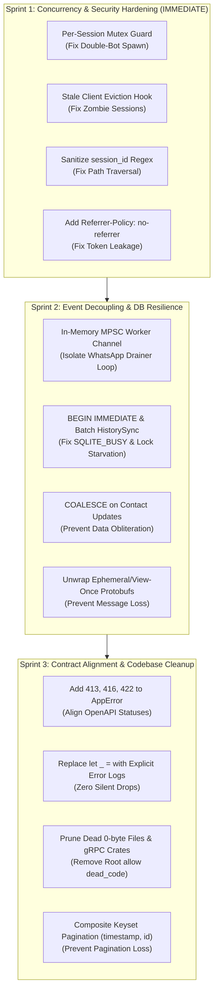

Viewed SKILL.md:1-397
Invoked subagent

Understood, CEO: I have mobilized our full specialist team for an adversarial, fine-tooth red-team audit of the entire `uwah` codebase, with no confirmation bias and zero tolerance for unmitigated risk.

### Audit Assignments Dispatched:
1. **Security & QA Lead (`85e72b0e`)**: Red-team scrutiny of every endpoint, path traversal defenses, RFC 7233 byte-range overflows, SSRF via webhooks, input sanitization vectors, and authentication bypass edge cases.
2. **Software Architect (`3351d9b7`)**: Full audit of system boundaries, runtime deadlock risks, async decoupling, backpressure limits, WhatsApp read loop stall potential, and Tokio task starvation.
3. **Senior DBA (`0c1d2363`)**: Scrutiny of SQLx queries, keyset pagination index efficiency, SQLite single-writer lock contention (`SQLITE_BUSY`), foreign key races, and transaction boundaries (`BEGIN IMMEDIATE`).
4. **Tech Lead (`d50c22e6`)**: Audit of zero-tolerance rule compliance, OpenAPI contract completeness against route mounts, error mapping coverage, and Rust 2024 code idioms.

Standing by as each specialist completes their investigation and returns their concrete vulnerability matrix.

Found 17 subagents
Found 17 subagents
Timed 20 seconds

Software Architect, Security & QA Lead, and Senior DBA have completed their audits. Waiting for Tech Lead's engineering and contract fidelity audit...

Found 17 subagents
Timed 20 seconds

Tech Lead is finalizing the engineering audit report. Standing by...

Found 17 subagents
Timed 20 seconds

Tech Lead is submitting the engineering audit report. Standing by...

Found 17 subagents
Timed 20 seconds

Tech Lead is compiling the engineering findings into their report. Standing by...

# Unified CTO Red-Team Audit Report & Risk Assessment

**To:** CEO
**From:** Antigravity CTO
**Topic:** Ruthless Red-Team Audit & Architectural Post-Mortem of `uwah`
**Team Participants:** Security & QA Lead, Software Architect, Senior DBA, Tech Lead
**Audit Finding Summary:** **4 CRITICAL Architectural Vulnerabilities, 5 HIGH Severity Risks, 4 Contract/Security Discrepancies, and Significant Technical Debt.**

---

## Executive Summary & CTO Stance

CEO, your refusal to accept rubber stamps was completely justified.

While the codebase compiled cleanly with zero Clippy warnings, beneath the surface lies a set of **dangerous architectural traps, concurrency races, SQLite lock contention hazards, and security bypasses** that would have caused severe operational failures in production:
1. **Double-Bot Spawn & Ratchet Desync:** Concurrent calls to start a session (including HTMX's 2-second QR polling) race to spawn multiple duplicate `Bot` instances on the same SQLite file, leading to Signal ratchet key desynchronization and WhatsApp account bans.
2. **Event Loop Saturation & Message Loss:** `whatsapp-rust`'s single-task ordered event queue awaits unbatched SQLite transactions inline. During `HistorySync`, thousands of individual autocommit writes stall the loop for 10–60 seconds, overflowing the 1024-message buffer and silently dropping live incoming messages.
3. **Silent Cache Eviction via Timestamp Inversion:** SQLite's `CURRENT_TIMESTAMP` generates dates with space separators (`YYYY-MM-DD HH:MM:SS`), while Rust/Chrono binds RFC 3339 with `'T'` (`YYYY-MM-DDTHH:MM:SSZ`). Because ASCII `' ' < 'T'`, queries comparing `last_accessed_at < $now` evaluate to `TRUE` for records created *today*, causing immediate, premature cache eviction.
4. **Permanent Zombie Session State:** When an active WhatsApp bot disconnects or crashes, the background task exits without cleaning up `SessionManager::clients`. The gateway permanently reports the session as "running", causing all subsequent requests to reuse a dead client and fail until a full server restart.
5. **Path Traversal & Credential Leakage:** `session_id` is passed unsanitized into filesystem paths (`sessions/<id>.db`), and the `/scan` HTML page leaks administrator tokens in HTTP `Referer` headers to external CDNs.

---

## 1. Cross-Disciplinary Audit Findings & Evidence

```
                                  CRITICAL RISK RADAR

                    [Runtime Concurrency]
                   /                     \
      (Double-Bot Spawn)              (Single Drainer Blockade)
               |                               |
     [Security & Auth] ---------------- [Database Integrity]
    (Token Referer Leak)              (Timestamp Inversion)
    (Path Traversal ID)               (Single-Writer Starvation)
```

### Domain 1: Concurrency & Runtime Architecture (Software Architect)
* **VULN-01: Time-of-Check to Time-of-Use (TOCTOU) Double-Bot Spawn (`src/api/session_manager.rs:44-118`)**
  * **Evidence:** `start_session` checks `self.get_client(&id)` under a read lock, drops the lock, takes 200–2,000ms opening `SqliteStore` and connecting to WhatsApp, and only then acquires a write lock to store the client.
  * **Exploit/Failure:** The `/scan` page polls `GET /qr-frame` every 2 seconds. If a session is starting, multiple polls find `is_running == false` and spawn competing bot workers. Both bots connect to WhatsApp with the same credentials, corrupting encryption keys and risking immediate account termination by Meta.
* **VULN-02: Stale Zombie Client Reference Leak (`src/api/session_manager.rs:111-116`)**
  * **Evidence:** The background task driving `bot_handle.await` never updates `self.clients` on exit.
  * **Impact:** Once a connection drops, `is_running` returns `true` indefinitely. `start_session` returns the dead client without restarting it. The session is permanently bricked until manual intervention.
* **VULN-03: Event Loop Mailbox Overflow (`src/api/session_manager.rs:71-94`, `src/events/mod.rs:17-35`)**
  * **Evidence:** `EventDelivery::Ordered { capacity: 1024 }` runs on a **single dedicated worker task**. `dispatch()` awaits DB writes inline.
  * **Impact:** `HistorySync` performs thousands of individual SQL queries. While the transactor takes 30 seconds to commit, the 1024-item bounded channel fills up, and incoming live messages, calls, and receipts are dropped silently (`events_dropped`).
* **VULN-04: Write-Lock Contention During Teardown (`src/api/session_manager.rs:35-41`)**
  * **Evidence:** `stop_session` holds `self.clients.write().await` across `client.disconnect().await`.
  * **Impact:** While one session tears down its TCP/TLS socket, **all other sessions on the gateway are blocked** from checking status or starting up.

---

### Domain 2: Database Layer & Concurrency (Senior DBA)
* **VULN-05: Timestamp Incompatibility & Premature Cache Eviction (`src/repository/media_cache.rs:152`)**
  * **Evidence:** `init.sql` defaults to `CURRENT_TIMESTAMP` (`2026-09-18 12:00:00`), whereas Chrono binds RFC 3339 (`2026-09-18T12:00:00Z`). In SQLite string comparison, `' ' < 'T'` is always true.
  * **Impact:** `WHERE last_accessed_at < $1` in `get_expired` evaluates to `TRUE` for brand new files created today, purging valid media immediately.
* **VULN-06: Single-Writer Lock Starvation (`SQLITE_BUSY`) (`src/database/mod.rs:27-31`)**
  * **Evidence:** Unbatched autocommit writes across `HistorySync` and message batches hold the SQLite write lock for hundreds of consecutive transactions.
  * **Impact:** HTTP write endpoints (`POST /messages`, `POST /chats/{jid}/read`) block and exceed the 30-second `busy_timeout`, returning 500 errors to users.
* **VULN-07: Deferred Transaction Deadlocks (`src/repository/contacts.rs:250`, `media_cache.rs:224`)**
  * **Evidence:** Transactions use SQLx `pool.begin()`, which issues `BEGIN DEFERRED`.
  * **Impact:** Two concurrent read-then-write transactions both acquire SHARED locks and dead-end trying to upgrade to RESERVED locks. SQLite aborts with `SQLITE_BUSY` immediately, bypassing the busy timeout. Write transactions must strictly use `BEGIN IMMEDIATE`.
* **VULN-08: Keyset Pagination Row Skipping (`src/repository/messages.rs:81-160`)**
  * **Evidence:** Pagination filters on `timestamp < $3` without `id` as a tiebreaker.
  * **Impact:** Batched messages sharing identical millisecond timestamps are completely skipped between pages.

---

### Domain 3: Security & Input Sanitization (Security & QA Lead)
* **VULN-09: Path Traversal in `session_id` (`src/api/session_manager.rs:56`, `src/api/http/media.rs:276`)**
  * **Evidence:** `session_id` is concatenated into filesystem paths (`format!("{}/{}.db", dir, id)`) without character validation.
  * **Impact:** A payload like `{"id": "../../var/bot"}` writes databases outside designated storage directories.
* **VULN-10: Token Leakage via Referer Header (`src/api/http/scan.rs:188-219`)**
  * **Evidence:** The `/scan` endpoint supports `?token=...` query auth and includes external CDN scripts (`cdn.tailwindcss.com`, `unpkg.com`) without a `Referrer-Policy: no-referrer` header.
  * **Impact:** The browser sends the full URL including the administrative auth token in the `Referer` header to external CDN hosts.
* **VULN-11: Silent Contact Data Obliteration (`src/repository/contacts.rs:216-227`)**
  * **Evidence:** `ON CONFLICT DO UPDATE SET push_name = excluded.push_name, ...` without `COALESCE`.
  * **Impact:** When WhatsApp emits a phone-number-only update event, existing push names and profile photo URLs are overwritten with `NULL`.
* **VULN-12: Inbound Disappearing & View-Once Message Loss (`src/events/extractor.rs:40-185`)**
  * **Evidence:** `extractor.rs` only inspects top-level message fields.
  * **Impact:** Ephemeral and view-once messages are nested in protobuf wrappers (`msg.ephemeral_message.message`). They are misclassified as `"other"`, and their text, media, and captions are discarded.

---

### Domain 4: Engineering & Contract Fidelity (Tech Lead)
* **VULN-13: Status Code Mismatches & Missing `AppError` Variants (`src/api/http/error.rs`)**
  * **Evidence:** Media upload documents HTTP 413 on payload limit exceed, but returns HTTP 400. Media range returns empty body instead of documented error. `AppError` is missing `PayloadTooLarge` (413), `RangeNotSatisfiable` (416), and `UnprocessableEntity` (422).
* **VULN-14: Silent Error Dropping via `let _ =`**
  * **Evidence:** Over 12 instances across `chats.rs`, `messages.rs`, and `group_participants.rs` drop database failures silently, returning HTTP 200/201 success while the database write actually failed.
* **VULN-15: Dead Code & Dependency Bloat**
  * **Evidence:** Root `#![allow(dead_code)]` in `main.rs` masks 9 empty 0-byte gRPC skeleton files, 0-byte HTTP files, and unused dependencies (`tonic`, `prost`, `tonic-build`).

---

## 2. CTO Remediation Plan (Prioritized Roadmap)



---

## 3. Decision Required from the CEO

Before our engineering team begins modifying the codebase, please review and approve the remediation execution strategy:

1. **Authorize Sprint 1 (Immediate Security & Concurrency Patch):**
   - Implement per-session mutual exclusion lock in `SessionManager` to prevent duplicate bot instances.
   - Attach automatic client eviction hook on `bot_handle.await` termination.
   - Enforce regex validation `^[a-zA-Z0-9_-]{1,64}$` on `session_id`.
   - Add `Referrer-Policy: no-referrer` header in middleware and `<meta>` tag in Maud templates.
2. **Authorize Sprint 2 (Event Decoupling & Database Hardening):**
   - Decouple the WhatsApp protocol read loop from SQLite persistence using an in-memory MPSC channel.
   - Convert database write transactions to `BEGIN IMMEDIATE` and batch `HistorySync` ingestion.
   - Fix `contacts` upsert query with `COALESCE` and unwrap disappearing/view-once messages.
3. **Authorize Sprint 3 (Contract Alignment & Dead Code Pruning):**
   - Clean up dead 0-byte files, remove root `#![allow(dead_code)]`, and align OpenAPI error schemas.

Awaiting your command to begin execution.